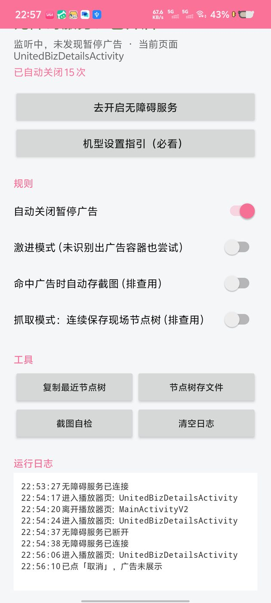
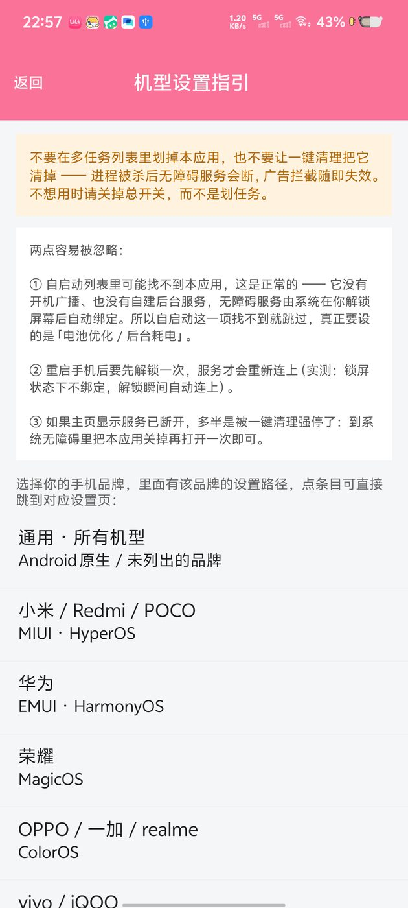

# 跳过B站暂停广告（BiliPause）

免 root 自动关闭 **哔哩哔哩安卓端** 播放器暂停时弹出的广告层。
装好、开一次无障碍开关，之后暂停出广告时自动点掉「取消 / ×」，回到干净的暂停画面。

- APK 体积 ≈ **61 KB**
- **零权限**：整个应用没有申请任何 `uses-permission`，包括没有 `INTERNET` —— 物理上无法联网，无法上传任何数据
- 不 root、不装 Xposed / VirtualXposed、不改 B 站安装包、不抓包不走 VPN
- 只在 B 站前台 + 只在播放器页 + 只在确实检测到广告层时才动手

**下载**：[Releases → v1.4 APK](https://github.com/Giant511/BiliPause/releases/latest)（也可直接用仓库里的 `out/BiliPauseAd-1.4.apk`）

 

## 原理

`AccessibilityService` 读取 B 站当前窗口的控件树（B 站没混淆资源 id，部分控件带可读 id / 内容描述），
每条规则都要求"**证据组合**"齐全才动手，然后通过 `ACTION_CLICK` 或坐标手势点掉目标。
本质是把你手动点关闭这个动作自动化，属于系统无障碍辅助能力，不篡改任何应用。

### 两级策略（按优先级）

**一手 · 掐死在展示前**

暂停后 B 站会先弹一条提示：`3秒后将展示广告　取消`。
识别条件：树里存在文案「后将展示广告」（秒数不敏感，1/3/5 秒都认），
且「取消」与它在同一行、位于文字右侧 —— 这个组合几乎唯一，才点。
点掉「取消」广告根本不展示，比事后关更干净。

**兜底 · 关掉已弹出的广告卡片**

广告卡片形态（B 站 9.10.0 实测）：

```
卡片容器 View [33,871,1227,2726]
  ├ TextView "美团神券"              ← 广告标题
  ├ View clickable → desc="dislike"  ← ⋯ 更多，不能点
  ├ View clickable → desc="close"    ← ★ 要点的 ×（本身不可点，父节点可点）
  └ TextView "广告"                  ← 角标，卡片左下
```

识别条件：有 close 语义的小控件（id 含 close/skip，或描述/文案是 close、关闭、跳过、×），
沿它的祖先链向上找到一张"卡片级容器"（面积占屏 8%~85%，且容器内存在「广告」角标），
再要求它贴近该容器右上角。缺任意一条都不点。

## 安装

前置：手机打开「开发者选项 → USB 调试」，USB 连电脑，手机上点「允许调试」。

### 方式一：脚本（推荐）

```bat
scripts\install.bat      :: 安装 + 解除受限设置 + 开无障碍 + 启动
```

### 方式二：手动

1. 把 `out\BiliPauseAd-1.1.apk` 传到手机安装（首次会提示"未知来源"）
2. 打开应用 → 点「去开启无障碍服务」→ 在列表里找到「跳过B站暂停广告」→ 打开
3. **Android 13 及以上**：侧载应用的无障碍开关可能置灰，需要
   `设置 → 应用 → 跳过B站暂停广告 → 右上角 ⋮ → 允许受限制的设置`
   （脚本 `install.bat` 已用 `appops` 自动解开）

## 使用

打开应用，顶部显示「无障碍服务：已开启」即生效。四个开关：

| 开关 | 默认 | 说明 |
|---|---|---|
| 自动关闭暂停广告 | 开 | 总开关 |
| 激进模式 | 关 | 仅在既找不到「广告」角标也找不到广告容器时放宽前置条件，阈值更高，仍不做盲点 |
| 命中广告时自动存截图 | 关 | 排查用，存在 `/sdcard/Android/data/com.luoqiang.bilipause/files/` |
| 抓取模式 | 关 | 排查用，每 2s 存一份现场节点树，只留最近 12 份 |

> B 站只在**非全屏**的播放页才会弹暂停广告；全屏播放不会弹，此时本应用什么都不做，也不扫描。

杀进程/重启后无障碍服务会自动恢复，不需要重新设置。

## 机型设置指引（应用内）

主页第二个按钮「机型设置指引（必看）」进去后，按 **品牌 + ROM** 选，而不是按具体型号 ——
这几个设置入口真正的差异在 ROM（MIUI/HyperOS、ColorOS 版本、OriginOS…），同品牌不同型号几乎一样，
列一个型号库反而会误导。共 9 组：通用、小米/Redmi/POCO、华为、荣耀、OPPO/一加/realme、vivo/iQOO、
三星、魅族、中兴/努比亚/其他。

每个品牌给出两样东西：

1. **手动路径**（文字步骤），永远可用；
2. **四个直达按钮**，点了直接跳到对应设置页：

| 按钮 | 跳到哪 |
|---|---|
| ① 无障碍服务 | 系统无障碍设置 |
| ② 自启动 / 后台运行 | 厂商自启动管理页（vivo: 自启动；小米: 自启动管理…） |
| ③ 电池优化 / 后台耗电 | 优先厂商页，没有就用系统电池优化列表 |
| ④ 应用详情页 | 本应用的应用信息页（所有机型通用兜底） |

跳转全部使用系统设置或厂商设置页的 `ComponentName`，**不需要任何权限**（没有 `QUERY_ALL_PACKAGES` 也能拉起）。
每个厂商都配了多个候选组件，挨个试；全打不开会提示并自动退回「应用详情页」，让你按文字路径手动找。
厂商改版频繁，这种"能跳就跳、不能跳就给路径"的做法比硬编码一个入口稳。

实测（vivo V2507A / OriginOS，adb 逐个验证跳转结果）：

| 按钮 | 实际落点 |
|---|---|
| ① | `com.android.settings/.Settings$AccessibilitySettingsActivity` |
| ② | `com.vivo.permissionmanager/.activity.BgStartUpManagerActivity`（自启动） |
| ③ | `com.iqoo.powersaving/.BackgroundHighUsageActivity`（后台耗电管理） |
| ④ | `com.android.settings/.applications.InstalledAppDetails` |

页面顶部还有一条橙色提醒：不要在多任务里划掉、不要让一键清理清掉，进程被杀服务就断。

### 两个实测结论（vivo V2507A 上验证）

**1. 自启动列表里找不到本应用，是正常的，跳过即可。**
本应用没有声明开机广播（连 `RECEIVE_BOOT_COMPLETED` 都没有），也没有自建后台服务 —— 无障碍服务是系统在
**用户解锁屏幕后**主动绑定的，不依赖应用自启动。实测该机型「自启动」列表只列 63 个应用（系统里第三方应用共 89 个），
本应用不在其中；而「后台耗电管理」列表里**有**本应用，那才是真正需要设的一项。

**2. 重启后会自动恢复，但要先解锁一次。**
实测时间线：重启 → 锁屏状态 `Bound services` 为空 → 解锁瞬间 `无障碍服务已连接`（22:52:18），全程无需手动操作。
原理是文件级加密（FBE）：用户数据在首次解锁前不可用，无障碍服务只能在解锁后绑定。

**3. 被强停（force-stop / 某些"一键加速"）会直接关掉无障碍服务。**
实测 `am force-stop` 之后，`enabled_accessibility_services` 里本应用的条目会被系统移除，且不会自动恢复。
恢复办法：到系统「无障碍 → 已下载的服务」里把本应用**关掉再打开一次**。应用主页会显示「服务已断开」提醒你。

## 常驻与耗电

**为什么能常驻**：无障碍服务是由系统（`system_server`）绑定的，不是应用自己起的后台服务。
进程优先级因此是 `oom_score_adj = 100`（VISIBLE_APP），比普通后台应用（900+）、比服务进程（500）都更不容易被回收。
应用自身**没有**常驻通知、没有自建 Service、没有定时任务、没有网络，所以也没有"保活"这回事。

实测（vivo V2507A / Android 15，pid 未变视为未被回收）：

| 场景 | 结果 |
|---|---|
| 静置 60 秒（B 站不在前台） | CPU **0 jiffies = 0.00%**，零扫描 |
| B 站播放 + 暂停 48 秒 | CPU **20 ms ≈ 0.04%** |
| 熄屏 30 秒后亮屏 | pid 不变，服务未重启 |

节流策略：只在 B 站**播放器页**才扫描；最短间隔 300ms；弹幕风暴（1s 内 >200 事件）自动降到 800ms；
点完一次冷却 900ms；灭屏、切后台、进首页一律零扫描。

**厂商后台管理**：国产 ROM 对后台另有管控，建议手动放行一次（adb 改不了厂商白名单）：

- 「设置 → 应用 → 跳过B站暂停广告 → 电池 / 后台耗电管理」→ 允许后台高耗电
- 「i管家 / 手机管家 → 应用管理 → 自启动」→ 允许自启动（保证重启后能自己恢复）
- 已通过 `dumpsys deviceidle whitelist +com.luoqiang.bilipause` 加入 Doze 白名单，等同于「电池优化 → 不优化」

**不要在多任务列表里把它划掉**：划掉会杀进程，无障碍服务会被系统重新拉起（通常几秒），
但厂商 ROM 可能不再拉起。不想用时请关掉应用里的总开关，而不是划掉任务。

## 出问题怎么反馈

B 站改版后如果规则失效，按这个顺序取证：

1. **抓取模式**（最推荐）：打开开关 → 去 B 站暂停，等广告出现并停留 2~3 秒 → 回到应用关掉开关。
   现场会落在 `/sdcard/Android/data/com.luoqiang.bilipause/files/capture/`，只留最近 12 份。
   `adb pull /sdcard/Android/data/com.luoqiang.bilipause/files/capture` 即可取。
2. 应用主页 **复制最近节点树** → 直接粘贴给维护者（内存里留的是最近一次命中的现场）。
3. `scripts\collect.bat`：在广告出现的那一刻运行，一次性抓 uiautomator / View 层级 / SurfaceFlinger / 截图到 `debug\`。
4. 日志：`adb logcat -s BiliPause` 能看到每条规则的命中分数与命中原因。

## 构建

前置：
- Android SDK：`platforms/android-34` + `build-tools/34.0.0`
- JDK 8：只用它的 `javac` 和 `keytool`
- JRE 17：只用它的 `java` 跑 `d8`/`apksigner`（d8 从 build-tools 31 起要求 Java 11+）。**仓库不带这个大文件**，自己下：

```bat
mkdir tools && cd tools
curl -LO https://mirrors.tuna.tsinghua.edu.cn/Adoptium/17/jre/x64/windows/OpenJDK17U-jre_x64_windows_hotspot_17.0.21_9.zip
tar -xf OpenJDK17U-jre_x64_windows_hotspot_17.0.21_9.zip
ren jdk-17.0.21+9-jre jre17
```

签名密钥 `keystore\bilipause.jks` **不在仓库里**（也不该在）。`build.bat` 发现没有就会用固定口令自动生成一个；
如果你要发布自己的版本，建议自己 `keytool -genkeypair` 生成并妥善备份 —— 换密钥意味着老用户必须卸载重装。

```bat
build.bat
```

链路（无 Gradle、无 Android Studio）：

```
aapt2 compile → aapt2 link → javac(JDK8) → d8(JRE17) → jar 塞 classes.dex
→ zipalign → apksigner(v2+v3)
```

产物：`out\BiliPauseAd-<版本>.apk`

> `d8` 从 build-tools 31 起要求 Java 11+，而本机只有 JDK 8，所以 `tools\jre17` 是必须的，它只用来跑 d8/apksigner，不影响系统 `JAVA_HOME`。

## 签名密钥（重要）

`keystore\bilipause.jks`，口令 `bilipause123`，别名 `bilipause`。

**这个文件必须留着**。Android 不允许签名不同的包覆盖安装：换了密钥就只能卸载重装（会丢设置和命中计数）。
备份它，别提交到公开仓库。

## 目录

```
AndroidManifest.xml                     零 uses-permission
build.bat                               一键构建
keystore\bilipause.jks                  长期签名密钥（务必备份）
res\xml\accessibility_service_config.xml 无障碍服务配置（flag 缺一不可）
res\layout\activity_main.xml            单页界面
src\com\luoqiang\bilipause\
  AdGuardService.java   服务主体：事件入口、屏幕开关、扫描线程
  EventGate.java        节流：包名/页面门禁、300ms 去抖、风暴降频、单飞行
  RuleEngine.java       调度：扫→判→点→复查→无果冷却并留证据
  PauseAdRule.java      识别：广告容器 + 关闭候选打分
  Safety.java           安全红线：文案/id 黑名单、面积上限
  Clicker.java          三级点击：ACTION_CLICK → 小号可点祖先 → 坐标手势
  NodeWalker.java       限深限量遍历 + 节点树导出
  ScreenProbe.java      API 30+ 截图（关在嵌套类里，避免旧系统类加载失败）
  MainActivity.java     状态面板
scripts\install.bat     安装一条龙
scripts\enable-acc.bat  仅开无障碍（先读再拼接，不会清掉你已有的服务）
scripts\collect.bat     真机取证
scripts\make_icon.py    图标生成
tools\jre17             仅用于 d8/apksigner 的 Java 17 运行时
```

## 已知限制

- 仅对 `tv.danmaku.bili` 生效，B 站国际版/概念版包名不同，需要改 `AdGuardService.BILI`
- 若某版本把暂停广告画进 `SurfaceView`/自绘图层，控件树里读不到，任何无障碍方案都无效（此时只能用截图识别，代价高，未默认启用）
- 各厂商 ROM 对无障碍自动点击有差异，个别系统需要额外允许「后台弹出界面」或关闭省电限制
- 广告样式随版本变化，规则需要跟着维护；应用会在失效时留节点树，便于快速修

## 声明

- 仅供**个人无障碍辅助**使用：把「用户本人在暂停页点一下关闭」这个动作自动化，不修改、不破解 B 站客户端，不拦截任何网络请求，不绕过会员/付费内容。
- 与哔哩哔哩官方无关，未获其授权或背书。「B 站」「哔哩哔哩」为其权利人商标，此处仅作描述性使用。
- 依赖无障碍服务读取界面控件，请自行评估风险；不使用时可随时在系统设置里关掉。
- 因使用本软件产生的任何后果由使用者自行承担。

## License

[MIT](LICENSE)
